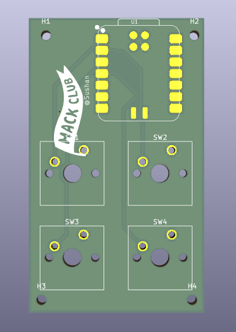
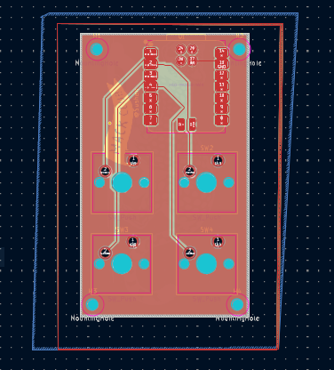
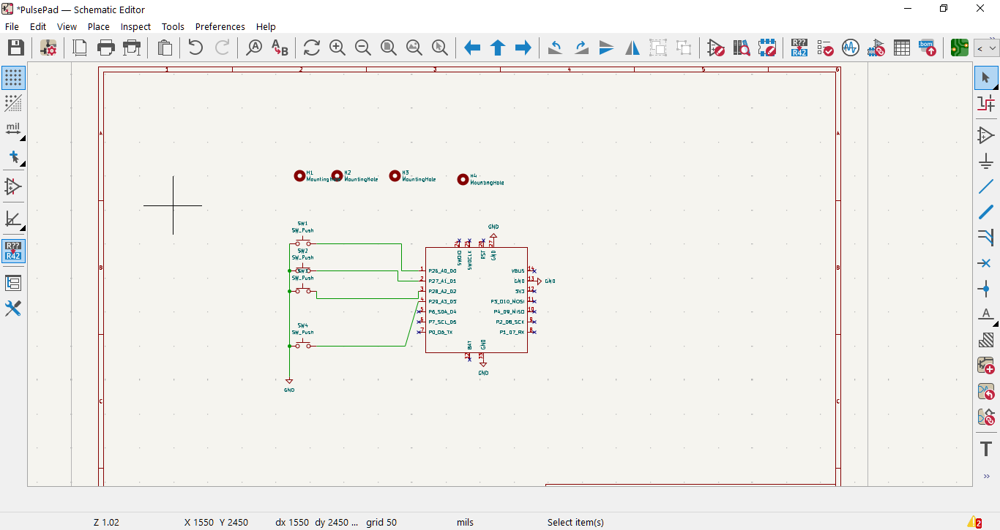

# PulsePad
PulsePad is an ultra-compact, open-source 4-key micropad hardware design powered by the **Seeed Studio XIAO RP2040** microcontroller. Designed for maximum efficiency and a minimalist footprint.

# BOM
| ID | Designator | Footprint | Qty | Designation|
|---:|---|---|---:|--- |
| 1 | C1, C2, C3, C4 | C_0402_1005Metric | 4 | 100 nF 
| 2 | SW1, SW2, SW3, SW4 | SW_Cherry_MX_1.00u_PCB | 4 | SW_Push 
| 3 | U1 | XIAO-RP2040-SMD (1) | 1 | XIAO-RP2040-SMD 

# 3d model

# 3d front view of pcb

# 3d back view of pcb

# pcb

# schematics

##  Acknowledgements
This project was designed and brought to life using **KiCad EDA**. Huge thanks to the open-source KiCad community for providing such an incredible, powerful, and accessible tool for hardware developers.

---

##  License
This project is open-source. Feel free to modify, manufacture, and adapt it for your own personal use!
